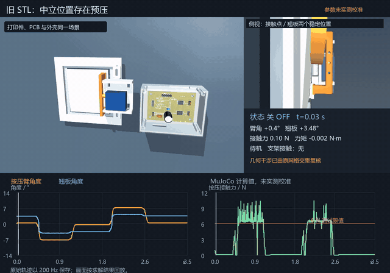
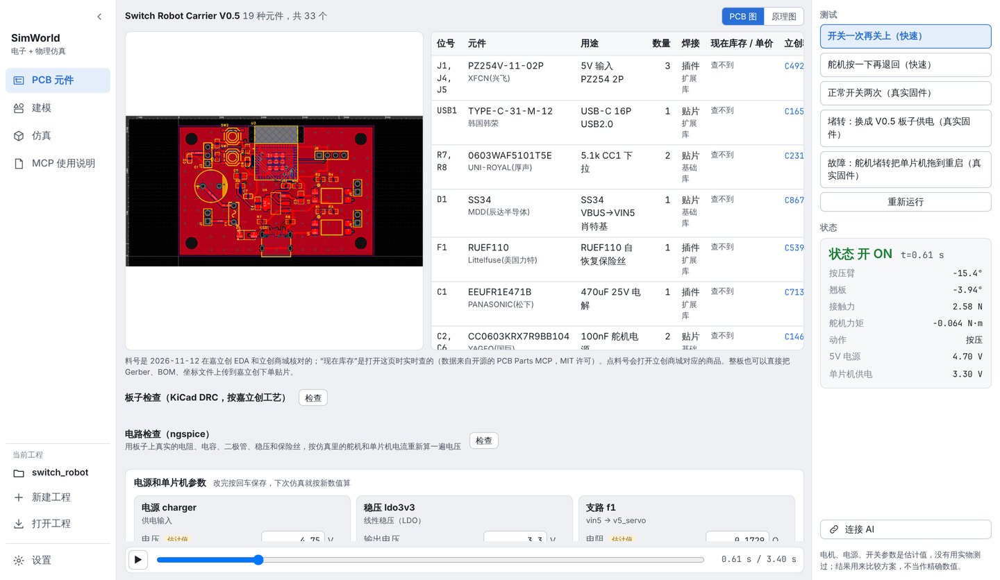
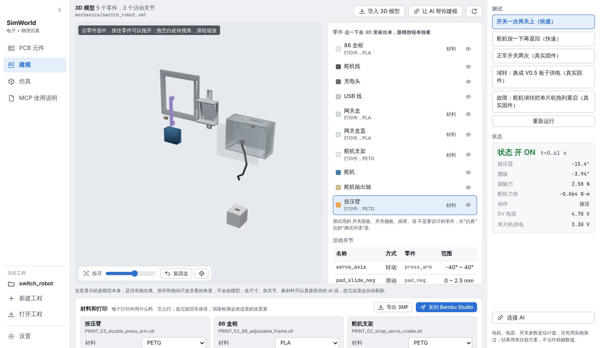
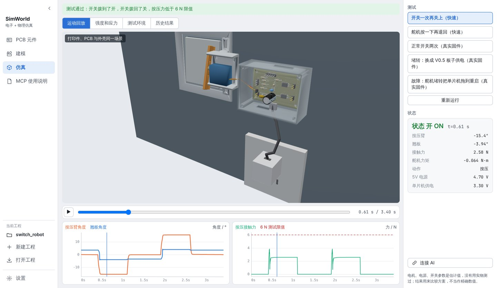
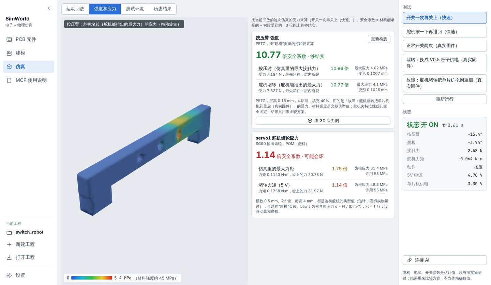
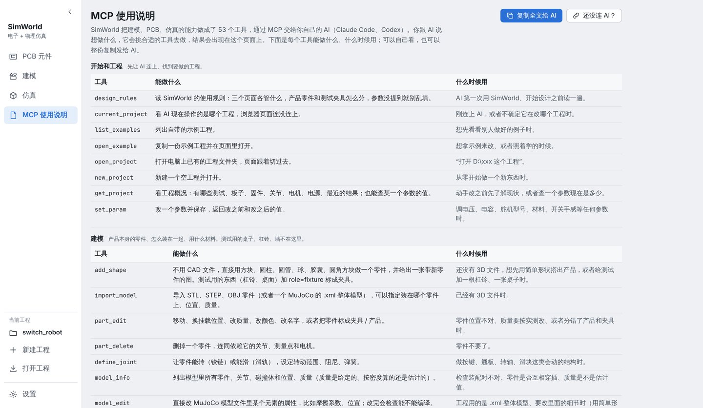

# SimWorld

SimWorld 让你在电脑上把一个带电路的小硬件先“造”出来测一遍：PCB 板、3D 打印的外壳和机构、单片机程序放进同一个场景，跑真实的电路和物理测试，看它会不会掉电、卡住、断掉。你不用会写前端，也不用学一堆专业软件：用自己的 AI（Claude Code、Codex）通过 MCP 告诉它想做什么，结果会出现在浏览器里的 SimWorld 页面上。

上面是自带示例“按墙上开关的舵机机器人”的物理测试：打印件、PCB 和外壳在同一个场景里，舵机把开关按下去再退回，右边和下面是关节角度、接触力的实时曲线。点图片可以看原视频。

## 用来做什么

做一个小硬件，通常要在 EDA、CAD、切片软件、示波器之间来回切换，问题往往要等打印、焊好、通电以后才暴露。SimWorld 把这几步放进同一个页面，在动手做实物之前就能回答这些问题：

- 电路：元件选得对不对，嘉立创有没有货，板子过不过 DRC，舵机一启动电压会不会掉到单片机重启。
- 结构：零件装不装得上，用 PLA 还是 PETG，按多少层墙、多少填充打印才不会断。
- 联合：真实固件（ESP32 在 QEMU 里跑）驱动电机，电机带动机构，机构的受力再反过来算零件强度和齿轮应力。

## 三个页面

页面按做事的顺序分成三页，每页只管一件事。

**PCB 元件**：所有电路相关的东西：元件清单和立创料号、原理图和板子、KiCad 检查、ngspice 电路检查、电源和单片机参数、引脚接线。

**建模**：只放你要设计的产品本身：零件、怎么装在一起、材料和打印设置。零件可以拆开、单独看、拖动。测试用的杠铃、桌子、墙不在这里。

**仿真**：把产品、板子和测试夹具放在一起跑测试，看 3D 回放和曲线；按这次的受力算打印件强度，出一张按应力着色的 3D 参考图，还有舵机齿轮应力和历史结果对比。

## 理念：前端不写死，交给 AI 在规则里完成

现在的 AI 写代码很快，一个工具不必做成什么都写死的大软件。SimWorld 只把该固定的东西固定下来，其余交给你的 AI：

- 写死的部分：计算内核（MuJoCo 物理、ngspice 电路、KiCad 检查、QEMU 跑固件、有限元强度），工程的数据格式，MCP 工具，还有几种显示组件（3D 视图、曲线、表格、图片）。
- 交给 AI 的部分：建哪些零件、画什么电路、加什么测试、调哪些参数。AI 通过 MCP 工具把这些写进工程数据，页面按数据自己显示出来，AI 不需要也不允许去改页面代码。
- 约束 AI 的是一份 skill（[emcosim/skills/simworld/SKILL.md](emcosim/skills/simworld/SKILL.md)）：三个页面各管什么，哪些是产品零件、哪些是测试夹具，你没提到的参数不乱填，估计值要说明是估计的。

左侧菜单的“MCP 使用说明”用大白话列出每个工具能做什么、什么时候用，可以自己看，也可以一键复制发给 AI。

## 快速开始

Windows 10/11：

    git clone https://github.com/cnYui/SimWorld.git
    cd SimWorld
    scripts\setup.cmd
    scripts\start.cmd

Linux / macOS 用 `scripts/setup.sh` 和 `scripts/start.sh`。安装脚本会建 Python 环境，并下载 KiCad、ngspice 和打过补丁的 QEMU。

打开页面后点右下角“连接 AI”，把复制的话发给你的 Claude Code 或 Codex，它会自己配好 MCP 并装上 SimWorld 的 skill。然后直接跟它说，比如“打开示例工程跑一下开关测试”，或者“新建一个工程，帮我做一个杠铃计数器”。

## 更多

- 技术细节（架构、时钟同步、参数校准、强度计算、导入格式、已知局限）：[docs/details.md](docs/details.md)
- 自带示例和它复现的问题：[examples/switch_robot/DEMO.md](examples/switch_robot/DEMO.md)
- 所有电机、电源、开关参数的默认值都是按公开规格估的，没有用实物标定；结果适合用来比较方案，不能当成精确数值。

代码里的包名和命令叫 emcosim。主体用 Apache-2.0 许可；QEMU 补丁是 GPL，KiCad、ngspice、QEMU 都作为独立程序运行，由安装脚本下载，不在本仓库里（见 NOTICE）。
