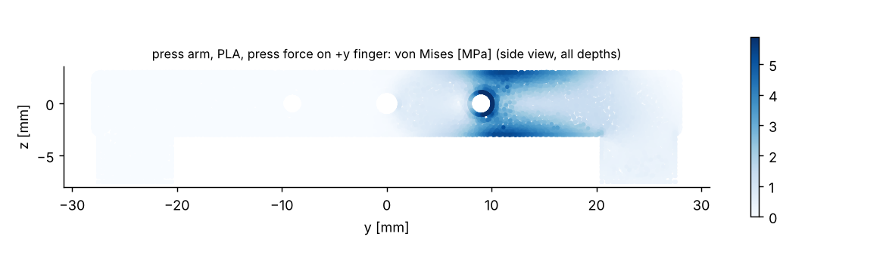
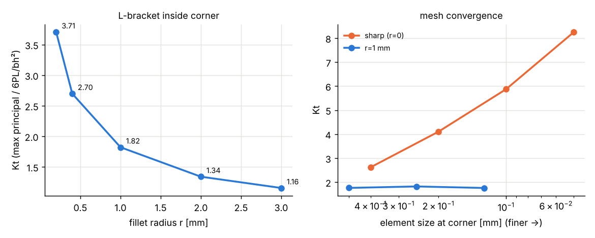
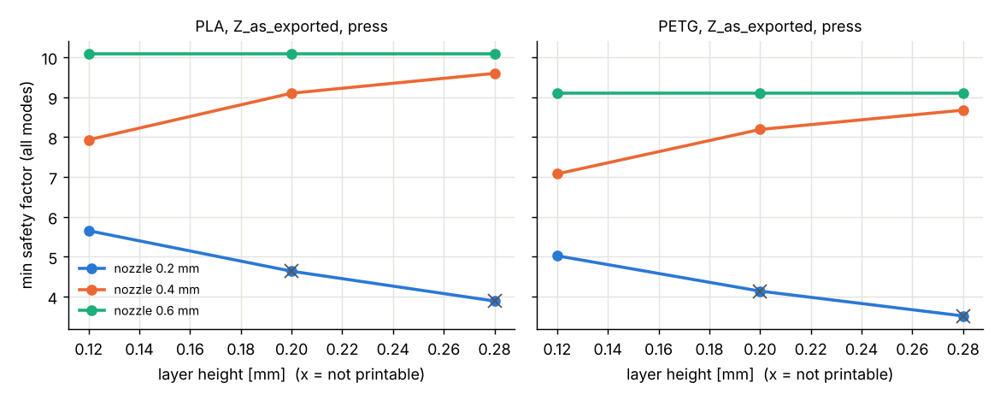

# 按压臂强度校核（FDM 打印件，线弹性静力有限元）

对象是 V0.6 双指按压臂 PRINT_03_double_press_arm.stl，用 emcosim.strength 做了线弹性静力有限元：二次四面体，材料按 FDM 的横观各向同性处理（层内和沿打印方向两套参数），外壁和顶底层按实体、内部填充按 20% grid 折减刚度和强度，失效按层内、层间拉、层间剪和层间组合四种方式分别算安全系数。载荷取自仿真运行 20261112-103919-820-stall_brownout（stall_brownout，9 N 硬开关、舵机堵转）。本报告由 run_strength.py 生成，所有数值都依赖下面列出的假设，没有任何实物测试。

结论先说：在 8.91 N 的接触力峰值下，按压臂本体不是薄弱环节。两种材料、三种打印朝向里最小安全系数是 4.7（PLA，Y_upright，层间组合），其余都更高；指尖最大变形不到 167 µm。朝向的影响明显：竖着打（Y_upright）时棒材的弯曲应力正好垂直于层面，层间拉成为控制模式，安全系数降到平放的一半左右；现在 STL 的导出朝向（Z_as_exported，棒材 4×56 面贴床、指杆朝上）和侧放（X_on_side）都让弯曲应力落在层内，二者差别不大。真正需要担心的是长期蠕变（PLA）、舵盘和螺丝的连接、以及指杆根部的尖角，后面分别说明。

## 载荷

loads_from_run 读取 runs/<id>/run.json 和 signals.npz：probe.press.force_n（压臂碰撞体与翘板碰撞体的接触力）峰值 8.91 N，出现在 t = 1.000 s；act.servo1.torque 的峰值 0.1732 N·m。舵机预设 sg90 在 5.0 V 下按 V/R·ke·减速比·效率 算出的堵转力矩是 0.1758 N·m（motors.py 注释给的是 0.1765 N·m）。工况一（press）把接触力峰值作为指杆底面（压垫粘接面）上的均布力，方向沿 +z（翘板把指杆往上顶）；工况二（torque）把堵转力矩换算成同一接触点的等效力 T / 24 mm = 7.33 N。接触力峰值比堵转等效力大，是因为撞上硬开关那一刻有臂和齿轮系的惯性冲击，所以 press 是控制工况。两个工况都在舵盘处固定：三个孔（中心 r1.25、y = ±9 的两个 r1.1）的孔壁全约束，相当于螺丝和孔壁粘死，舵盘端面的接触和螺丝预紧都没建；这让孔边的应力是理想化的，所以孔和加载面 1.0 mm 以内的节点不参与最小安全系数统计（结果里另存了含这些点的原始值）。

## 材料和打印参数（全部是假设值）

材料表在 emcosim/strength/materials.py，取自 Prusament、Bambu Lab 等材料数据表里 XY 与 Z 方向拉伸样条的典型值和几篇文献的范围，对应 0.2 mm 层高、0.4 mm 喷嘴、实心样条，都没有在本项目实测，实际离散度在 ±30% 以上。层间拉伸强度取层内的 30%~60%。

| 材料 | E_xy MPa | E_z MPa | G_xz MPa | 层内拉 MPa | 层内压 MPa | 层间拉 MPa | 层间剪 MPa | 软化温度 °C |
|---|---|---|---|---|---|---|---|---|
| PLA | 3300 | 2900 | 1100 | 50 | 65 | 25 | 20 | 55 |
| PETG | 2000 | 1800 | 700 | 45 | 55 | 25 | 18 | 75 |
| ABS | 2100 | 1800 | 700 | 32 | 45 | 14 | 12 | 95 |
| ASA | 2000 | 1750 | 680 | 33 | 45 | 15 | 12 | 95 |
| PA-CF | 6000 | 2500 | 900 | 75 | 70 | 25 | 22 | 150 |

PLA 在室温下就会蠕变，持续受力（比如压臂长期顶住开关、或者舵机保持力矩）时变形会慢慢增加；接近玻璃化温度（约 55~60 °C）明显变软，夏天车里或靠近发热器件时，远低于上表的应力也可能让零件下垂。这个校核只算短时静力，没有蠕变和疲劳，所以对 PLA 持续载荷建议安全系数至少 3~4。PETG 软化温度更高、更韧，蠕变比 PLA 小。

基准打印参数：层高 0.2 mm，喷嘴 0.4 mm（线宽 0.45 mm），3 圈外壁（1.35 mm），顶底各 4 层（0.80 mm），20% grid 填充。打印参数进入模型的方式（PrintSettings，均为假设关系）：离表面不到外壁厚度（侧面）或顶底层厚度（法向接近打印方向的面）的区域按实体算，其余是填充芯，刚度乘 ρ^n、强度乘 ρ^m（ρ 为填充率，grid 取 n = m = 1，即按实体比例混合；gyroid 取 1.6/1.5）；层间强度随层高/喷嘴比变化，比值 0.5 时为 1，系数 1 + 0.6×(0.5 − h/d)，限制在 0.5~1.15，可选的喷嘴温度每高 1 °C 加 0.5%；层高超过喷嘴直径 80% 视为不可打印；侧壁上的层纹按浅缺口 Kt = 1 + 2√(0.12h/0.05 mm)、静载缺口敏感系数 0.3 折算，相对 0.2 mm 层高放大侧壁表面垂直于层面的拉应力；内圆角能可靠做出的最小半径取喷嘴直径的一半（圆角在层面内由走线形成时），圆角靠层的台阶堆出来时取两倍层高。

失效判据在材料坐标系（1、2 在层面内，3 沿打印方向）里逐点计算：层内用层面内两个主应力分别对比层内拉、压强度；层间拉用 σ33（只算拉）对比层间拉伸强度；层间剪用 √(σ13² + σ23²) 对比层间剪切强度；层间组合用二次式 (σ33⁺/Zt)² + (τ/S)² = 1/SF²（Hoffman/Tsai-Hill 在层面上的简化形式）。安全系数 = 强度 / 应力，按节点（二次单元的顶点和棱中点，相邻单元应变取平均）取最小值。

## 按压臂结果

三种朝向（打印方向写在零件坐标系里：x 是舵机轴、棒材厚 4 mm；y 沿棒材；z 向上，指杆朝 −z）：

- Z_as_exported：打印方向 -z，bar 4x56 face on the bed, fingers up (current STL pose)
- X_on_side：打印方向 x，bar 6x56 side face on the bed (fingers lie flat)
- Y_upright：打印方向 y，standing on one bar end, bar length vertical

表中是排除孔边和加载面 1 mm 后的最小安全系数（>99 表示该模式基本不受力），变形是全零件最大位移。

| 材料 | 朝向 | 工况 | 层内 | 层间拉 | 层间剪 | 层间组合 | 控制模式 | 最大变形 mm |
|---|---|---|---|---|---|---|---|---|
| PLA | Z_as_exported | press | 9.1 | 23.5 | 11.7 | 11.7 | 层内 | 0.098 |
| PLA | Z_as_exported | torque | 11.1 | 28.5 | 14.2 | 14.2 | 层内 | 0.081 |
| PLA | X_on_side | press | 9.0 | 55.6 | 30.9 | 30.1 | 层内 | 0.097 |
| PLA | X_on_side | torque | 10.9 | 67.7 | 37.6 | 36.7 | 层内 | 0.080 |
| PLA | Y_upright | press | 34.7 | 4.7 | 11.7 | 4.7 | 层间组合 | 0.104 |
| PLA | Y_upright | torque | 42.3 | 5.7 | 14.2 | 5.7 | 层间组合 | 0.085 |
| PETG | Z_as_exported | press | 8.2 | 21.7 | 10.5 | 10.5 | 层内 | 0.161 |
| PETG | Z_as_exported | torque | 10.0 | 26.4 | 12.8 | 12.8 | 层内 | 0.132 |
| PETG | X_on_side | press | 8.1 | 47.4 | 27.6 | 26.8 | 层内 | 0.161 |
| PETG | X_on_side | torque | 9.8 | 57.7 | 33.6 | 32.6 | 层内 | 0.133 |
| PETG | Y_upright | press | 29.9 | 4.7 | 10.4 | 4.7 | 层间组合 | 0.167 |
| PETG | Y_upright | torque | 36.4 | 5.7 | 12.7 | 5.7 | 层间组合 | 0.137 |

最小值都出现在棒材靠近舵盘的一段：y 约 11 mm、棒材上下表面附近（例如 PLA Z_as_exported 层内模式在 (-0.1, 11.2, -3.0) mm），也就是舵盘螺丝孔外侧、悬臂弯矩最大的位置。手算校核：力 8.9 N、到 y = 11 mm 的力臂 13 mm，4×6 mm 截面弯曲应力约 4.8 MPa，与有限元一致。剪切和层间组合模式的最小值在中间填充芯里：填充芯强度按 20% 折减，所以即使应力不高也会先到。朝向的差别：PLA 最好的朝向是 Z_as_exported，PETG 是 Z_as_exported；Y_upright 时层间拉控制，安全系数最低。PETG 的刚度低，变形比 PLA 大约 60%，但强度表里两者层间强度接近，安全系数差别不大。

指杆根部（指杆内侧面 y = ±20.5 mm 与棒材下表面 z = −3 mm 的交线）是尖的内角，有限元在那里的峰值随网格加密不断变大，不是真实应力，所以 1 mm 范围内单独统计，不进上表（当前网格下该区域最小安全系数约 20.8，只作参考）。在 Z_as_exported 和 Y_upright 两种朝向里，这条棱的一个面正好是层面（是在层分界上），也就是应力集中点和层间熔接线重合，这是最不利的组合；X_on_side 时棱平行于打印方向，圆角由走线形成。不过这个角离加载点只有 3.5 mm，弯矩很小（约 9 N × 3.5 mm ≈ 31 N·mm，名义应力约 1.3 MPa），即使按下面圆角研究里尖角附近的 Kt ≈ 3~4 估算也只有 4~5 MPa，不控制强度。如果以后加长指杆或改成侧向受力，这个角要加圆角。

## 内角圆角研究

尖内角是奇异点，峰值没有意义，所以用一个内置的参数化 L 形支架代表这类内角：立壁 6×16 mm 底面固定，悬臂 20 mm 长、4 mm 高、4 mm 宽，端面受 10 N 向上的力，使内角受拉；gmsh OCC 生成精确的圆弧圆角并在圆角处局部加密。Kt 定义为圆角附近最大主应力除以悬臂根部名义弯曲应力 6PL/(bh²) = 18.75 MPa。半径默认取喷嘴直径的一半（0.2 mm，可靠做出的最小内圆角）、0.4（线宽量级）、1、2、3 mm。表里的安全系数只对应这个 10 N 的示例载荷（名义应力已经 18.75 MPa，远高于按压臂上的应力），用来比较不同半径和朝向的相对差别，不是按压臂的安全系数。Kt 是几何量，三种打印方向下只因刚度各向异性略有差别；安全系数下表用 PLA、打印方向沿悬臂轴（x），这时立壁面是层面、最大主应力几乎垂直于层面，是最坏组合。

| r mm | Kt | 峰值应力 MPa | 层内 SF | 层间拉 SF | 层间组合 SF | 角在层分界上 | 峰值方向垂直层面 |
|---|---|---|---|---|---|---|---|
| 0.2 | 3.71 | 69.5 | 0.9 | 0.4 | 0.4 | 是 | 是 |
| 0.4 | 2.70 | 50.6 | 1.3 | 0.6 | 0.5 | 是 | 是 |
| 1 | 1.82 | 34.2 | 2.1 | 0.8 | 0.8 | 是 | 是 |
| 2 | 1.34 | 25.1 | 3.0 | 1.0 | 1.0 | 是 | 是 |
| 3 | 1.16 | 21.7 | 3.5 | 1.2 | 1.2 | 是 | 是 |

对照：打印方向 z 时 Kt 为 3.83、2.80、1.87、1.38、1.18（同样的半径顺序），r = 1 mm 的最小安全系数 1.0，角在层分界上；打印方向 y 时 Kt 为 3.80、2.77、1.86、1.35、1.16（同样的半径顺序），r = 1 mm 的最小安全系数 1.4，角不在层分界上。打印方向 z 时悬臂下表面是层面，角也在层分界上，但峰值应力沿悬臂方向、落在层内；打印方向 y 时圆角棱平行于打印方向，圆角由每层的走线形成，半径小于喷嘴一半时做不出来。PETG 在最坏方向（x）的结果见 results.json 的 fillet.x_PETG。

网格收敛：r = 1 mm 时把圆角处单元尺寸从 r/2 加密到 r/8，Kt 为 1.76（0.5 mm）、1.82（0.25 mm）、1.76（0.125 mm），基本收敛；尖角（r = 0）从 0.4 mm 加密到 0.05 mm，"Kt" 为 2.62、4.10、5.87、8.25，一直上升不收敛，说明尖角的峰值只反映网格尺寸，不能直接拿来判断强度。实际打印出的尖角也不是数学上的尖角，而是一个大小不受控的小圆角加层纹缺口，所以设计上应给出明确的圆角，0.4 mm 打印时至少 1 mm，能放下 2 mm 更好：从表上看 r 从 0.4 增到 2 mm，Kt 大约减半。

## 打印参数扫描

对按压臂的 press 工况、各材料最好的朝向，扫描层高 {0.12, 0.2, 0.28} mm × 喷嘴 {0.2, 0.4, 0.6} mm（3 圈外壁），以及 0.4 mm 喷嘴、0.2 mm 层高下外壁 {2, 3, 4} 圈，填充都是 20%。为了控制时间，扫描用更粗的网格（目标棱长 1.2 mm，主表是 1.0 mm），与主表同一参数下的数值会有几个百分点的差别。表中是所有模式里的最小安全系数和对应模式；0.2 mm 喷嘴配 0.28 mm 层高超过喷嘴 80%，标为不可打印，仅作外推参考。

PLA（Z_as_exported，press）：

| 喷嘴 mm | 外壁 | 外壁厚 mm | 层高 0.12 | 层高 0.2 | 层高 0.28 |
|---|---|---|---|---|---|
| 0.2 | 3 | 0.68 | 5.7 层间剪 | 4.6 层间剪（不可打印） | 3.9 层间剪（不可打印） |
| 0.4 | 3 | 1.35 | 7.9 层内 | 9.1 层内 | 9.6 层内 |
| 0.6 | 3 | 2.02 | 10.1 层内 | 10.1 层内 | 10.1 层内 |
| 0.4 | 2 | 0.90 | - | 7.7 层间剪 | - |
| 0.4 | 3 | 1.35 | - | 9.1 层内 | - |
| 0.4 | 4 | 1.80 | - | 9.7 层内 | - |

PETG（Z_as_exported，press）：

| 喷嘴 mm | 外壁 | 外壁厚 mm | 层高 0.12 | 层高 0.2 | 层高 0.28 |
|---|---|---|---|---|---|
| 0.2 | 3 | 0.68 | 5.0 层间剪 | 4.1 层间剪（不可打印） | 3.5 层间组合（不可打印） |
| 0.4 | 3 | 1.35 | 7.1 层内 | 8.2 层内 | 8.7 层内 |
| 0.6 | 3 | 2.02 | 9.1 层内 | 9.1 层内 | 9.1 层内 |
| 0.4 | 2 | 0.90 | - | 6.9 层间剪 | - |
| 0.4 | 3 | 1.35 | - | 8.2 层内 | - |
| 0.4 | 4 | 1.80 | - | 8.7 层内 | - |

PLA：0.4 mm 喷嘴下层高 0.12 → 0.28 mm，最小安全系数 7.9 → 9.6；0.2 mm 层高下喷嘴 0.2 → 0.6 mm，4.6 → 10.1；外壁 2 → 4 圈，7.7 → 9.7；PETG：0.4 mm 喷嘴下层高 0.12 → 0.28 mm，最小安全系数 7.1 → 8.7；0.2 mm 层高下喷嘴 0.2 → 0.6 mm，4.1 → 9.1；外壁 2 → 4 圈，6.9 → 8.7。在这个零件上，外壁圈数和喷嘴（决定外壁厚度）影响最大：棒材只有 4 mm 厚，外壁变厚后填充芯变小甚至消失，控制模式从填充芯里的层间剪切转到外壁上的层内应力；层高主要通过层间强度系数和层纹缺口起作用，在层间不控制的朝向上影响较小；0.4 mm 喷嘴下层高越小安全系数反而略低，是因为顶底层数固定为 4 层，0.12 mm 层高时顶底实体只有 0.48 mm，填充芯变大（实际可以按厚度而不是层数设顶底层）。建议按压臂用 0.4 mm 喷嘴、0.2 mm 层高、至少 4 圈外壁（相当于实心），填充率对这么细的零件意义不大。

## 局限和没有算的东西

材料数值全是文献和数据表的典型值，没有本项目的拉伸样条；不同品牌、颜色、受潮状态、打印机和冷却风扇都会让层间强度变化很大，层间数值的不确定性最大。打印参数的影响（层高、温度、填充、层纹缺口）是按趋势设定的简单关系，量级是估计，没有拟合实验。模型是小变形线弹性静力，没有塑性、蠕变、疲劳、冲击速率效应和温度；按压是反复动作（每天若干次），PLA 的长期蠕变和疲劳可能比这里的静强度更早出问题。固定方式是理想化的：孔壁全约束比真实的螺丝加塑料舵盘更硬，真实情况下舵盘本身、M2 自攻螺丝在 PLA 孔里的拔出、孔边挤压可能先坏，这些都没有算，孔边 1 mm 内的结果不可信。载荷方向取零件坐标系的 +z，没有考虑按压角度（约 17°）带来的侧向分量和摩擦；压垫是外购弹性体，只作为受力面。打印缺陷（欠挤出、气孔、层间开裂、翘曲、拉丝）都不在模型里，填充芯按均匀连续体折算，壳/芯边界由节点到表面的距离判断，分辨率约为网格尺寸。网格：fTetWild 由 STL 生成，体积误差 0.2%（STL 是闭合的；不闭合时 fTetWild 用缠绕数判断内外并给出警告）。

## 复现

    pip install -e "platform[strength]"
    cd platform/examples/switch_robot && emcosim run stall_brownout      # 生成 runs/（不进 git）
    python strength/run_strength.py                                       # 约 10 分钟，4 核

设置 EMCOSIM_STRENGTH_RUN=<run_id> 可指定运行；默认取 stall_brownout 运行里接触力峰值最大的一次。配置在 strength/press_arm.yaml（零件坐标变换、固定、加载面、尖角区域），完整数值在 results.json。本次总用时 13.4 分钟。
